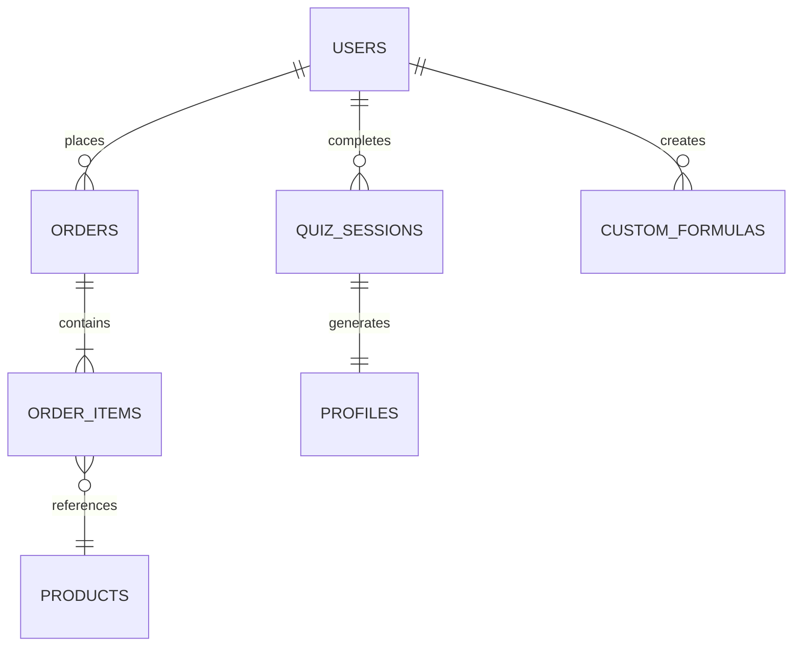

# PJ Essence — Data Model & Schema

## 1. Entity Relationship Overview



---

## 2. Firestore Document Schemas

### 2.1 Collection: `users`
```typescript
interface UserDocument {
  id: string; // Auth UID
  email: string;
  fullName: string;
  phone?: string;
  role: 'CUSTOMER' | 'ADMIN';
  savedAddresses?: Array<{
    id: string;
    fullName: string;
    street: string;
    city: string;
    state: string;
    zip: string;
    country: string;
    isDefault: boolean;
  }>;
  createdAt: string; // ISO 8601
  updatedAt: string;
}
```

### 2.2 Collection: `products`
```typescript
type ProductType = 'PERFUME' | 'CAR_PERFUME' | 'ROOM_FRESHENER';

interface ProductDocument {
  id: string;
  type: ProductType;
  name: string;
  slug: string;
  tagline: string;
  description: string;
  price: number;
  currency: 'USD' | 'EUR' | 'GBP';
  active: boolean;
  inventory: number;
  images: string[];
  seasonTags: Array<'WINTER' | 'SPRING' | 'SUMMER' | 'AUTUMN' | 'ALL_SEASON'>;
  occasionTags: Array<'DAILY' | 'EVENING' | 'ROMANCE' | 'MEDITATION' | 'SPECIAL'>;
  fragranceFamilies: Array<'Woody' | 'Oriental' | 'Floral' | 'Fresh' | 'Gourmand' | 'Chypre'>;
  intensity: number; // 1 to 10
  warmth: number;    // 1 to 10
  freshness: number; // 1 to 10
  sweetness: number; // 1 to 10
  notes: {
    top: string[];
    heart: string[];
    base: string[];
  };
  attributes: {
    concentration?: string; // For PERFUME
    volume?: string;        // For PERFUME
    mountType?: string;     // For CAR_PERFUME
    diffusionDuration?: string;
    dispenserType?: string; // For ROOM_FRESHENER
    coverageArea?: string;
  };
  createdAt: string;
  updatedAt: string;
}
```

### 2.3 Collection: `orders`
```typescript
type OrderStatus =
  | 'PENDING_PAYMENT'
  | 'PAID'
  | 'FORMULA_CONFIRMED'
  | 'IN_PRODUCTION'
  | 'QUALITY_CHECK'
  | 'PACKED'
  | 'SHIPPED'
  | 'OUT_FOR_DELIVERY'
  | 'DELIVERED'
  | 'CANCELLED';

interface OrderDocument {
  id: string;
  userId: string | null; // guest or auth user
  customerEmail: string;
  customerName: string;
  items: Array<{
    productId: string;
    productName: string;
    productType: ProductType;
    unitPrice: number;
    quantity: number;
    image: string;
    isCustom?: boolean;
    customFormulaId?: string;
    customFormulaNotes?: {
      top: string[];
      heart: string[];
      base: string[];
      engraving?: string;
    };
  }>;
  subtotal: number;
  shipping: number;
  tax: number;
  discount: number;
  total: number;
  currency: string;
  shippingAddress: {
    fullName: string;
    street: string;
    city: string;
    state: string;
    zip: string;
    country: string;
  };
  paymentStatus: 'UNPAID' | 'PAID' | 'REFUNDED' | 'FAILED';
  paymentSessionId?: string;
  orderStatus: OrderStatus;
  statusHistory: Array<{
    status: OrderStatus;
    timestamp: string;
    note?: string;
  }>;
  trackingNumber?: string;
  carrier?: string;
  createdAt: string;
  updatedAt: string;
}
```

### 2.4 Collection: `customFormulas`
```typescript
interface CustomFormulaDocument {
  id: string;
  userId: string;
  formulaName: string;
  engravedLabel: string;
  bottleColor: 'amber' | 'smoke' | 'clear' | 'frosted';
  capColor: 'bronze' | 'walnut' | 'gold';
  topNotes: string[];
  heartNotes: string[];
  baseNotes: string[];
  intensity: number;
  price: number;
  createdAt: string;
}
```

### 2.5 Collection: `quizQuestions`
```typescript
interface QuizQuestionDocument {
  id: string;
  order: number;
  active: boolean;
  question: string;
  helperText: string;
  seasonContext?: 'ALL' | 'WINTER' | 'SUMMER' | 'SPRING' | 'AUTUMN';
  options: Array<{
    id: string;
    label: string;
    description: string;
    scoring: {
      warmth?: number;
      intensity?: number;
      freshness?: number;
      sweetness?: number;
      families?: string[];
      notes?: string[];
    };
    nextQuestionId?: string; // For dynamic branching
  }>;
}
```
