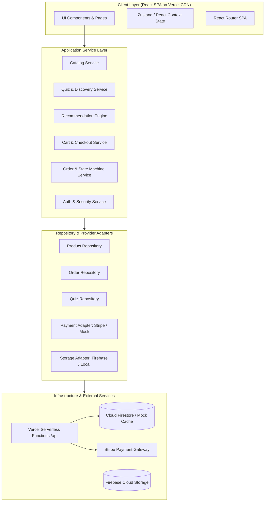

# PJ Essence — High-Level Design (HLD)

## 1. Executive Summary & Brand Philosophy

**PJ Essence** is a premier luxury fragrance-commerce platform dedicated to haute parfumerie, bespoke fragrance formulation, artisanal car perfumes, and luxury room fresheners.

The visual and technical architecture embodies:
- **Palette**: Deep Burgundy (`#6B1E2B`), Warm Bronze (`#B68A4C`), Cream (`#F8F2EA`), Walnut (`#5C4033`), and Soft Taupe (`#B6A89C`).
- **Experience**: Editorial, warm, restrained, evocative, and intuitive.
- **Natural Language Discovery**: Customers are not required to understand technical perfume terminology (such as volatile fractions or aldehyde classification) to discover or create their signature scent.

---

## 2. System Architecture

---

## 3. Core Modules & Boundaries

### 3.1 Customer Experience
1. **Editorial Landing (`/`)**: Hero storytelling, seasonal curations, fragrance note pyramid explorer, and direct guided quiz trigger.
2. **Fragrance Discovery (`/discover`)**: Olfactory education, note breakdown (Top, Heart, Base), fragrance families, and seasonal guides.
3. **Session-Aware Quiz (`/quiz`)**: Natural-language multi-step questionnaire with dynamic branching (e.g., Winter pathway unlocks warm amber/vanilla questions; Summer pathway unlocks marine/citrus questions).
4. **Bespoke Perfume Atelier (`/custom-perfume`)**: Interactive lab allowing clients to select base, heart, and top notes, adjust intensity ratios, preview custom engraved labels, and generate formulated batch orders.
5. **Product Catalog & Details (`/products`, `/products/:slug`)**: Polymorphic listings (`PERFUME`, `CAR_PERFUME`, `ROOM_FRESHENER`), debounced filtering, olfactory pyramid breakdown, and paired cross-sells.
6. **Cart & Secure Checkout (`/cart`, `/checkout`)**: Transparent cart calculation, luxury gift packaging toggle, address management, guest/authenticated checkout, and server-verified payment flow.
7. **Client Account & Order Tracking (`/account`, `/orders/:id`)**: Fragrance lab notebook, saved profiles, and real-time state machine order progression.

### 3.2 Admin Operations
1. **Executive Dashboard (`/admin`)**: Revenue, order volume, customer LTV, inventory health alerts, top fragrance families, and seasonal velocity.
2. **Product Catalog Manager (`/admin/products`, `/admin/products/new`, `.../edit`)**: Polymorphic creation (`PERFUME`, `CAR_PERFUME`, `ROOM_FRESHENER`), note assignments, pricing tiers, and stock management.
3. **Order State Machine Manager (`/admin/orders`)**: Enforces strict state transitions from formula confirmation to hand-packing and dispatch.
4. **Quiz & Recommendation Rules (`/admin/quiz`)**: Admin controls for conditional questionnaire rules, weighting vectors, and season triggers.
5. **Seasonal Campaigns (`/admin/seasonal`)**: Curated seasonal collection scheduling, banner updates, and discount campaigns.
6. **Media Asset Vault (`/admin/media`)**: High-res fragrance imagery management backed by cloud storage.

---

## 4. Architectural Patterns Applied

1. **Feature-First Organization**: High cohesion, low coupling across distinct business domains.
2. **Repository Pattern**: Strict isolation of data retrieval mechanisms; UI never touches database APIs directly.
3. **Strategy Pattern**: Extensible recommendation engine supporting `ruleBased`, `seasonal`, `hybrid`, and future ML models.
4. **Factory Pattern**: Polymorphic product instantiation ensuring validation and default attributes per category.
5. **Adapter Pattern**: Swappable infrastructure interfaces for Payments, Storage, Shipping, and Notifications.
6. **Finite State Machine (FSM)**: Deterministic order lifecycle preventing invalid status leaps.
7. **Dependency Inversion**: Services depend on abstract repository contracts, enabling offline mock operation or live Firebase connectivity without UI alteration.

---

## 5. Security & Compliance
- **Zero-Trust Client Payments**: No order is marked `PAID` from client-side state. Payment confirmation requires cryptographic webhook or serverless verification.
- **Role-Based Access Control (RBAC)**: Admin endpoints and UI views are strictly guarded via JWT verification and user role claims.
- **Sanitized Inputs**: All input vectors (quiz payloads, addresses, custom formula names) are validated before storage.
